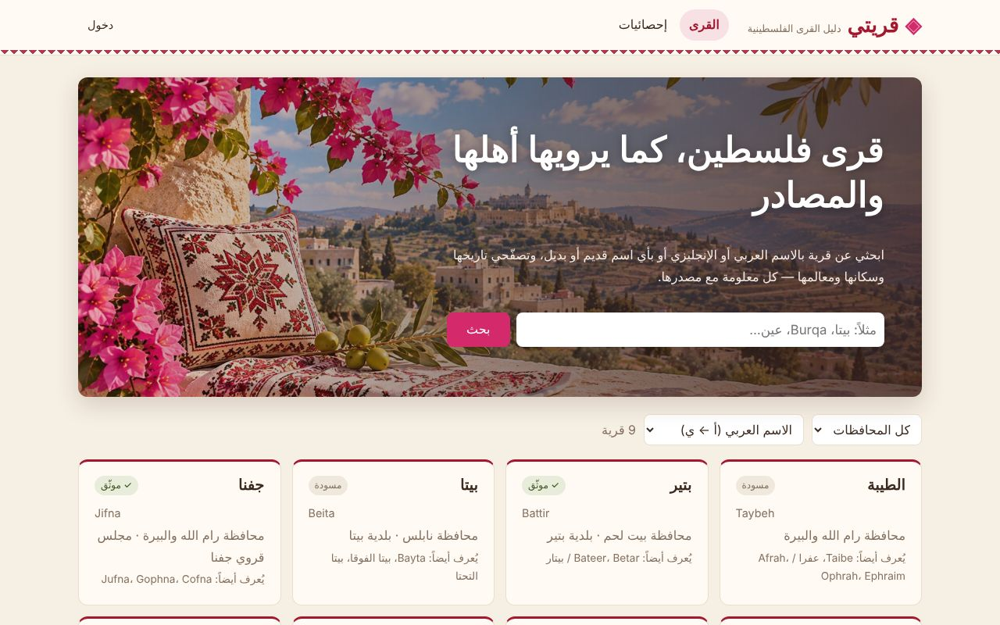
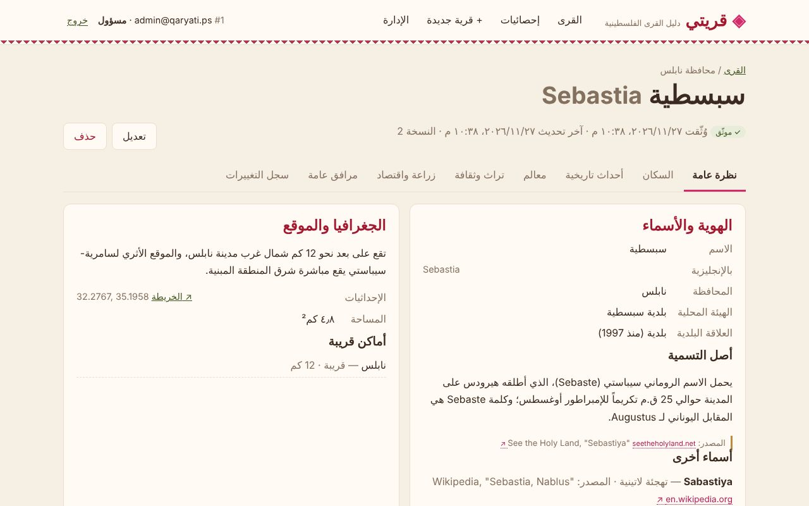
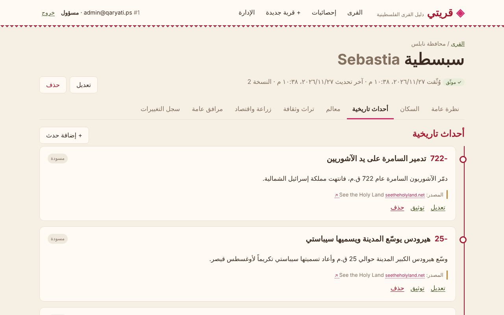
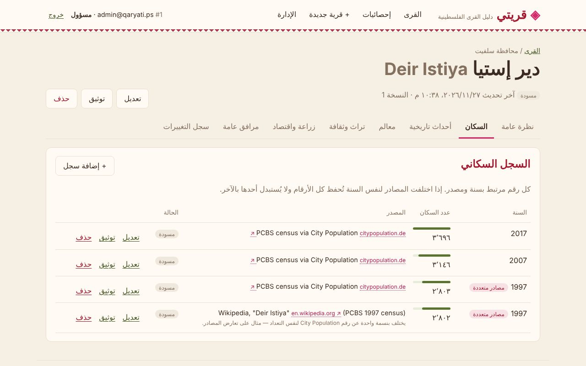
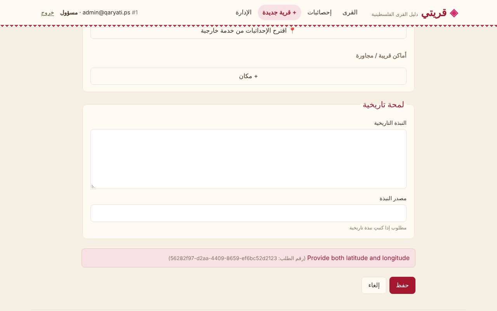
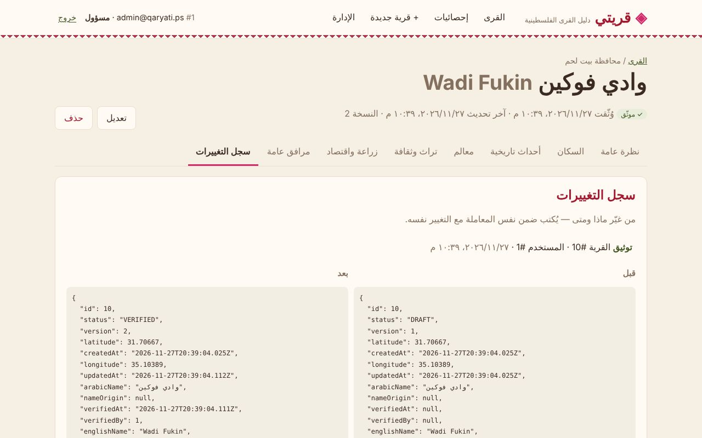
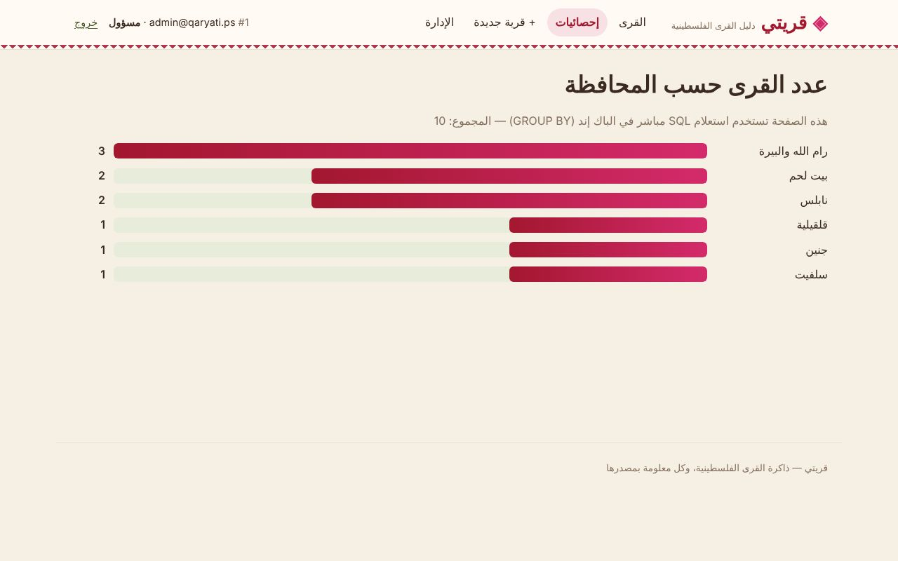

# Qaryati — Palestinian Villages Knowledge API

NestJS 12 / TypeScript / PostgreSQL 17 / Prisma 7. This continues the supplied village identity module. The backend is the graded deliverable; an optional React UI lives in [`frontend/`](frontend/README.md).

Guides: [Running and testing](docs/TESTING.md) | [Verification evidence](docs/VERIFICATION.md).

## Screenshots (web UI)

The optional React UI (Arabic, right-to-left) running against the real API and PostgreSQL, loaded with the sourced village data from [`seed/`](seed/README.md).

| | |
|---|---|
|  |  |
| **Home:** search by Arabic, English or historical names, filter by governorate | **Village page:** identity, alternative names, geography and history, each with its source |
|  |  |
| **Timeline:** historical events ordered by year | **Population history:** two sources disagree for 1997; both records are kept |
|  |  |
| **Editing:** validation errors from the API are shown to the user | **Audit log:** who changed what and when, with before/after snapshots |
|  |  |
| **Statistics:** villages per governorate (raw SQL endpoint) | **Mobile:** responsive layout |

## Quick start with Docker

1. Copy `.env.example` to `.env`. Choose a long, URL-safe PostgreSQL password (or percent-encode it in a custom connection URL). Do not reuse production credentials.
2. Run `docker compose up --build -d`. The database health check gates migrations; migration success gates the API.
3. Open http://localhost:3000/api-docs (API) or http://localhost:8080 (web UI). Readiness is `/api/v1/health/ready`.
4. Bootstrap a new administrator once. Set `ADMIN_EMAIL` and `ADMIN_PASSWORD` in your terminal environment, then run:

```sh
docker compose exec -e ADMIN_EMAIL -e ADMIN_PASSWORD api npm run admin:create
```

Use a 12–128 character password. This command refuses to replace an existing user and records a bootstrap audit event. Remove the password from the terminal environment afterward. No default admin account or committed password is supplied.

5. `POST /api/v1/auth/login`, then use the returned token in Swagger's **Authorize** dialog. Register collaborators with `/auth/register`; an administrator grants EDITOR or VERIFIER using `/auth/users/{id}/role`.

`docker compose down` stops containers and retains the volume. Do not use `down -v` against data you need. Existing data requires a backup before migration. No deployment to an external service has been performed.

## Local development

Use Node **24.9 or newer**, npm, and PostgreSQL. The NestJS 12 packages use ESM; Node 24 supports loading them from this project's existing CommonJS output.

```sh
npm ci
npm run prisma:generate
# Configure DATABASE_URL in .env for YOUR development database
npm run db:migrate
npm run build
npm run start:dev
```

The Compose database is exposed only on loopback, port **5433**, to avoid colliding with an existing 5432 installation. `prisma.config.ts` is the single Prisma configuration. Prisma clients are regenerated, not shipped as stale generated code.

## Features and boundaries

- Village identity, multilingual aliases, administrative affiliations, structured nearby places, coordinates, elevation and land area.
- Historical overview with provenance; population history with source-specific records.
- Typed knowledge entries: EVENT (year required), LANDMARK, HERITAGE, ECONOMY, FACILITY.
- Public paginated reads; authenticated, role-controlled writes; explicit verification.
- Optimistic version checks, atomic audit history, and role-change session revocation.
- Geocoding suggestions through an isolated Open-Meteo adapter with deadlines, bounded retries, cache and rate control.
- OpenAPI documentation, consistent errors, request IDs, health checks, Docker and CI.

Read [API conventions](docs/API.md), [architecture and ERD](docs/ARCHITECTURE.md), [security](docs/SECURITY.md), [decisions](docs/adr/001-architecture.md), and [verification status](docs/VERIFICATION.md).

## Testing

```sh
npm test -- --runInBand
npm run build
```

Unit tests and HTTP contract tests mock the database deliberately. Real transaction, cascade and race behavior is covered separately:

1. Create a dedicated PostgreSQL database whose name includes `test`.
2. Set `TEST_DATABASE_URL` and temporarily set `DATABASE_URL` to that same URL; run `npm run db:migrate`.
3. Run `npm run test:integration`. Test data is synthetic and cleanup is scoped to the created user/village.

The integration suite refuses to run without an explicitly named test database. CI provisions a disposable PostgreSQL service and performs these steps. See `performance/README.md` for the mandatory read/write load evaluation and honest before/after reporting workflow.

To run both suites with isolated container infrastructure, use `docker compose -p qaryati-check -f docker-compose.test.yml up --build --abort-on-container-exit --exit-code-from tests`, then `docker compose -p qaryati-check -f docker-compose.test.yml down`. The test database uses temporary storage and exposes no host port. The fourth migration requires PostgreSQL's `pg_trgm` extension (included in the standard PostgreSQL image); on managed databases, arrange extension privileges before deployment.
