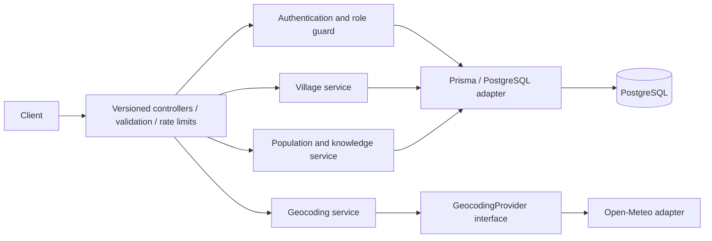
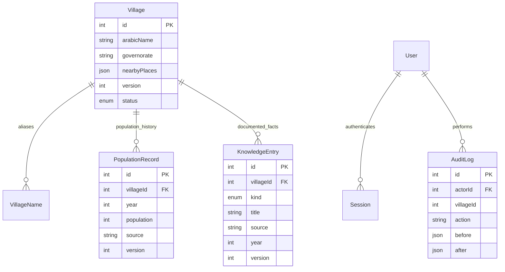

# Architecture and domain model

## Modular monolith

Controllers own HTTP mapping and DTOs; services own consistency, transactions and permissions' effects; shared domain helpers own provenance/version rules without importing Prisma; Prisma owns persistence and connection lifecycle. The audit persistence helper in src/prisma/audit.ts receives the service transaction client and never opens a separate transaction. JSON snapshot conversion lives in src/prisma/json.ts. External provider DTOs never become database records automatically. The GeocodingProvider contract owns both search and source attribution; GeocodingService uses that attribution for fresh and cached responses, so replacing a provider does not require editing provider names in the service. AuthGuard denies unannotated writes by default. Read policy is public unless a route explicitly requires roles.

NestJS was retained because the supplied module already used its dependency injection, decorators and validation. It provides test seams, cohesive modules and automatic request-schema documentation. Express alone would require assembling these conventions. Microservices would impose distributed transactions and operations work disproportionate to this course project. See ADR 001.

## ERD

`AuditLog.villageId` deliberately has no foreign key: the history survives village deletion. `verifiedBy` stores a user ID snapshot; user deletion is not exposed. A village deletion snapshots its aliases and child records in a SERIALIZABLE transaction before cascading; child edits are checked by their own versions. Each write and audit insert is one transaction: audit failure must roll back the write.

KnowledgeEntry shares the common sourced-fact fields across five types. `kind` supports filtering; `category` expresses crops/crafts/industry, school/clinic/library, or landmark type. Events require a year. This reduces five repeated CRUD modules while keeping population statistics separate and strongly typed. Separate tables become preferable if facility schedules, economic measures or other type-specific required fields grow.

Nearby places use bounded structured JSON (`name`, `relationship`, optional `distanceKm`). This permits nearby cities that do not yet have village records. It sacrifices referential links and spatial queries; introduce PostGIS / a Place relation only if those query requirements arise.

## Consistency and provenance

Null means unknown, not zero. Coordinates are paired. Name origin and historical overview require a source when populated. All population/knowledge entries require a nonblank citation. Population is a nonnegative integer, reference year is positive and not in the future. Different sources may disagree for a year: both records remain; identical village/year/source tuples are rejected. Sources are free-text references (title, publisher, year, page or URL), not automatically fetched URLs.

PATCH/DELETE/VERIFY require the current version. Compare-and-swap updates increment it, and return 409 for a stale version. Editors must reload and reconcile conflicts; no last-writer-wins behavior. Editing resets that record to DRAFT. Village verification covers village fields only; child verification is independent. Existing optional unknown fields may be null. Required fields cannot be cleared.

## Queries, indexes, caching

Village rows and their total count are read in a REPEATABLE READ transaction for a consistent page snapshot. Village lists retain search across Arabic/English names and aliases, governorate/council filters, stable sorting and bounded pages. Subresources have bounded pages and deterministic ordering. Raw parameterized `$queryRaw` demonstrates governorate aggregation without interpolated SQL strings. Indexes support foreign keys, population chronology, kind filters, session expiry and audit lookups. Measured selective-search scans led to GIN trigram indexes plus a parameterized UNION candidate query. The database applies pagination before ORM hydration; only a bounded page crosses the application boundary. See performance/RESULTS.md for the index-only experiment, final measurements and costs.

Village facts are not cached, avoiding invalidation complexity and stale verification status. Geocoding results are cached 24 hours (at most 500 names), concurrent identical calls share one request, uncached names are limited to one request start/second. At most one retry occurs on network/timeout/5xx; provider 429 and other 4xx fail without retry. Each attempt has a configurable deadline. Returned suggestions carry attribution and do not overwrite human-reviewed facts. Cache and rate state are process-local: use a shared store before multi-instance scaling.
